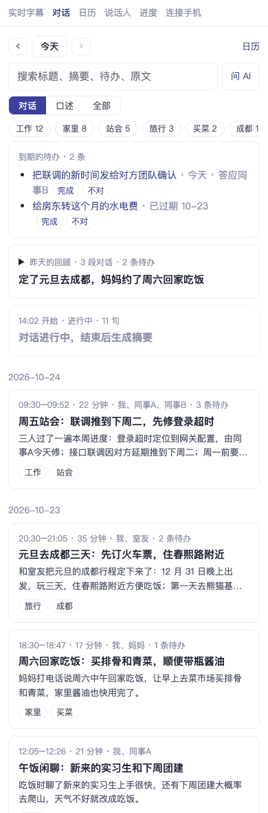
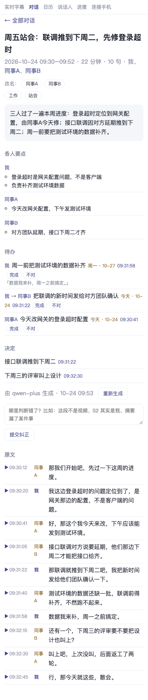
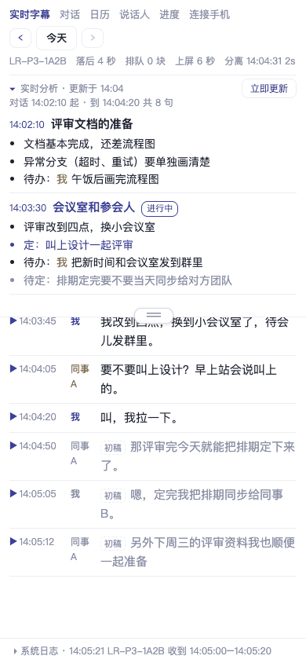
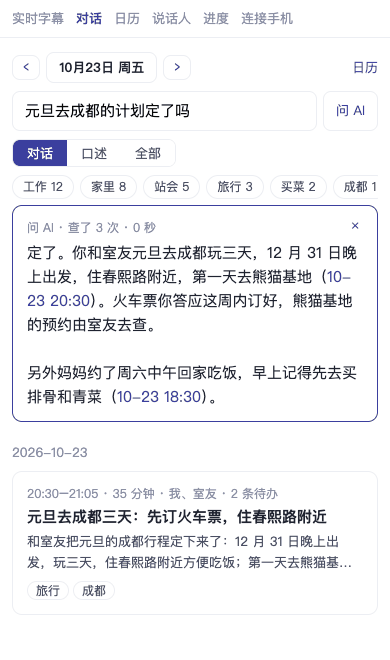
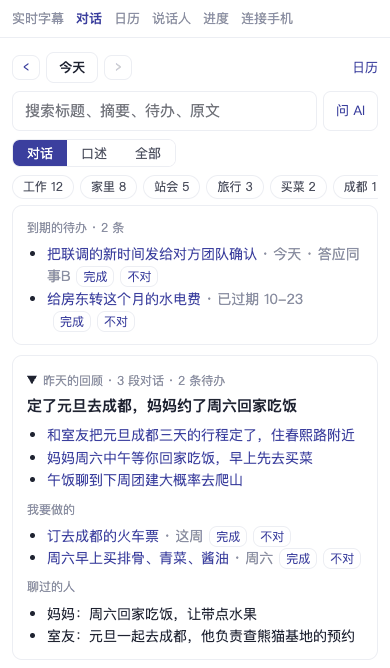
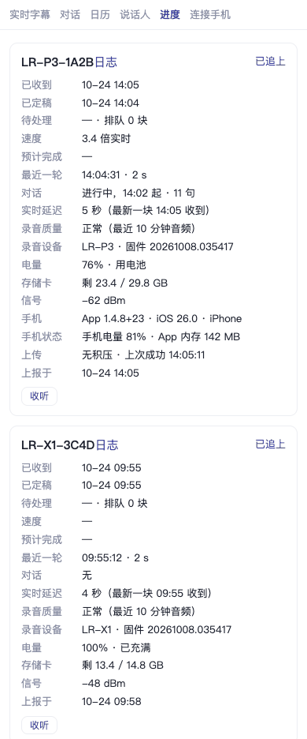
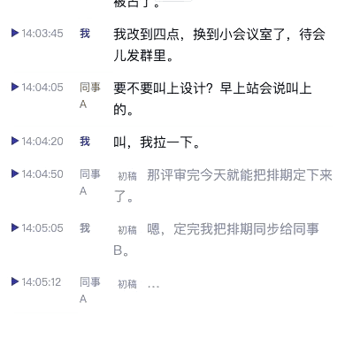
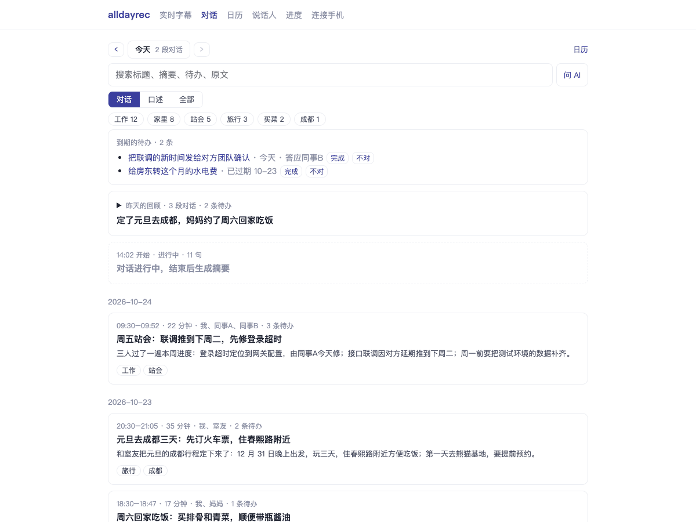

# alldayrec（全天录）

**中文** | [English](README.en.md)

**全天录（alldayrec）是一个自己部署的全天录音和个人记忆层。** 戴一个录音设备（或者只带手机）从早录到晚，自己的服务器在一分钟内把音频变成带说话人的转写、对话摘要、待办和每日回顾。它保留原始录音，每句话都能回放核对，以后有了更好的模型还能把过去重新转写一遍。它不挑设备（iPhone、安卓 App，或者几十块钱就能自己做的开源蓝牙录音硬件），支持 MCP，自己的 Agent 可以直接查你的每一天。可以把它当成自己托管的 lifelog：Limitless、Plaud、Bee、Omi 的开源替代，没有订阅，对话也不放在别人的云上。

「LR」「lr」是项目的内部代号，硬件和代码里还在用：录音设备型号 `LR-P3`、固件工具 `lr.sh`、命令行 `lr.py`。

仓库公开前改写过 git 历史，去掉了作者私人部署的细节，所以历史很短；提交说明里的 `lr#123` 指的是以前私有仓库的 issue，不是这个仓库的。

## 截图

网页在手机上的样子，示例数据都是编的（界面目前只有中文）。

|  |  |  |
|:--:|:--:|:--:|
| 对话列表：标题、摘要、标签、到期的待办 | 一段对话：摘要、每个人的要点、待办、决定、带说话人的转写 | 实时页：正在进行的对话的实时分析，边说边出初稿 |
|  |  |  |
| 问 AI：回答里附带出处对话的链接 | 每日回顾：要点、你的待办、和你说过话的人 | 进度：每台设备的队列、录音设备的电量和存储卡、手机、今天的语音识别和大模型调用 |

页面开着时的实时字幕（初稿层），以及电脑上的对话列表页：





## 能做什么

- **全天录音。** 手机 App 上传 Opus 短分片；蓝牙录音设备一直写 SD 卡，同时推给手机，断开期间的部分回来后补齐。离线时什么都不丢：分片在设备上排队，之后再上传。
- **什么音源都能接。** 能 POST 音频分片的东西都能给服务器送数据：`POST /api/chunks?device=<name>&start=<unix ms of its first sample>`（`start` 是第一个采样点的 Unix 毫秒时间），`Authorization: Bearer <token>`，请求体是一个自成一体的音频文件（App 发的 Ogg Opus 用 `Content-Type: audio/ogg`，也可以是 `audio/webm`、`audio/aac`）。见 `server/server.py` 里的 `chunk()`；`firmware/devkit/lr_sync.py` 是一个小的 Python 客户端。
- **两层转写。** 定稿层在停顿处切开，每段最长 5 分钟交给云端语音识别引擎（默认阿里云百炼千问，约 ¥0.05/小时音频）；页面开着时，初稿层几秒内出字。
- **认人。** 语音检测（FireRedVAD）和声纹（ReDimNet2）在本机 CPU 上跑（onnxruntime，不需要显卡），认得出你自己，分得清一段对话里的不同人，记得你起的名字。
- **记忆。** 一段安静之后对话结束，用你配置的大模型写摘要；待办和截止日期、每日回顾、全文搜索，以及对历史记录「问 AI」。说话不到 60 秒的对话不调大模型，标题取第一句，没有摘要和待办（`server/summary.py` 里的 `MIN_SPEECH_S`）。
- **开放。** 网页、给 Claude Code、Codex、Cursor 等 Agent 用的远程 MCP 端点（`POST /mcp`）、一个小命令行（`cli/lr.py`），数据就是 SQLite，自己就能读。
- **数据归你。** 一台服务器、你自己的硬盘，愿意的话一台服务器可以给好几个人用（每人一个 token）。音频只发给你选的语音识别引擎，转写只发给你选的大模型。

```
BLE recorder ──BLE──▶ phone app ──HTTPS──▶ server (FastAPI) ──▶ web UI, MCP, CLI
                      (or the phone's mic)    │ local: VAD, voiceprints (onnxruntime)
                                              │ cloud: ASR engine, OpenAI-compatible LLM
                                              ▼
                                       SQLite + original audio
```

| 目录 | 内容 |
|---|---|
| `server/` | 服务端：上传队列、VAD 和声纹、语音识别引擎、对话、摘要、MCP（Python 3.11，uv） |
| `web/` | 网页：实时转写、对话、说话人、日历、设备页（Vue，pnpm） |
| `app/` | iOS 和安卓手机 App：录手机麦克风或蓝牙录音设备、上传、固件升级（Flutter） |
| `firmware/devkit/` | nRF52840 板子的蓝牙录音设备固件（Zephyr / nRF Connect SDK），基于 Omi devkit |
| `firmware/selftest/`, `firmware/blerelay/` | 板子自检固件；测试用的 ESP32 蓝牙中继 |
| `cli/` | `lr.py`：在终端或 Agent 里读你的对话 |

## 快速开始（Docker）

需要一台装了 Docker 的 amd64 或 arm64 机器，以及一把[阿里云百炼（DashScope）](https://bailian.console.aliyun.com/)北京区的 API key。这一把 key 跑语音识别，也可以跑大模型（`.env.example` 里的 `qwen-plus`），前提是这把 key 没有在百炼控制台里限定可用模型：限定了模型的 key 调对话模型会返回 403。
没有语音识别的 key：`ENGINE=local` 在服务里跑语音识别（sherpa-onnx），只出文字，说话人靠内置声纹区分，远场录音比千问差；大模型的 key 仍然需要。

```bash
git clone https://github.com/suyiiyii/alldayrec && cd alldayrec
cp .env.example .env    # 填 DASHSCOPE_API_KEY 和 LLM_API_KEY（用示例的大模型设置时两者是同一把 key）
mkdir -p data && echo '[{"id": "main", "token": "'$(openssl rand -hex 16)'", "data": "/data/main", "recordings": "/data/main/recordings"}]' > data/tenants.json && chmod 600 data/tenants.json
docker compose up -d
docker compose logs -f  # 首次启动下载模型文件（约 55 MB），校验 sha256
```

用 `ENGINE=local` 时，第一段音频到达时服务还要再下载约 136 MB（sherpa-onnx 的模型包），所以第一条转写要等一分钟左右。

容器默认用 UTC，除非 `.env` 里设了 `TZ`（`.env.example` 里是 `TZ=Asia/Shanghai`）：对话的日期和 `RECAP_AT` 的触发时间都按这个时区算。

预构建镜像发布在 `ghcr.io/suyiiyii/alldayrec`（amd64/arm64），`docker-compose.yml` 用的就是它。想在本机构建，把 `docker-compose.yml` 里的 `build: .` 取消注释，再运行 `docker compose up -d --build`。

打开 `http://127.0.0.1:8770/?token=<your token>`（token 在 `data/tenants.json` 里；服务在远程机器上的话，先 `ssh -L 8770:127.0.0.1:8770 host`）；之后靠 cookie 保持登录。所有东西都在 `./data` 里：`tenants.json`、模型文件，以及每个人各自的 SQLite 数据库和原始录音。

手机连服务器需要 HTTPS：在 8770 端口前面放一个带 TLS 的反向代理（Caddy、nginx、Cloudflare Tunnel、Tailscale Serve）；`GET /api/health` 不需要 token 就返回 `{"ok": true}`，可以给代理做健康检查。compose 文件只把端口发布在 127.0.0.1 上；token 为空的服务不要暴露出去。

## 快速开始（不用 Docker）

需要 Python 3.11 和 [uv](https://docs.astral.sh/uv/)、ffmpeg、Node 22 和 pnpm。

```bash
git clone https://github.com/suyiiyii/alldayrec && cd alldayrec
cp .env.example .env    # 填 key，以及 MODELS_DIR=<一个可写目录的绝对路径>
(cd web && pnpm install && pnpm build)    # 网页构建到 server/static/dist
echo '[{"id": "main", "token": "'$(openssl rand -hex 16)'", "data": "'$PWD/data/main'", "recordings": "'$PWD/data/main/recordings'"}]' > tenants.json && chmod 600 tenants.json
cd server && uv sync && set -a && . ../.env && set +a && uv run python server.py
```

`tenants.json` 列出服务为哪些人服务：每人一条，各有自己的 token、数据目录和录音目录（`server/tenant.py`）。只有一条且 token 为空时不做认证：这样的服务只能放在 127.0.0.1 上。

### 模型文件

服务器上跑两个模型，都用 CPU：[FireRedVAD](https://github.com/FireRedTeam/FireRedVAD)（语音检测，Apache-2.0）和 [ReDimNet2](https://github.com/PalabraAI/redimnet2) B6（声纹，MIT）。不需要你做任何事：首次启动时服务会把缺的文件下载到 `MODELS_DIR`（Docker 里是 `data/models`），FireRedVAD 从上游仓库下载，ReDimNet2 从本仓库的 `models-v1` Release 下载（`ENGINE=local` 还会在第一次用到时下载 sherpa-onnx 的模型包），只接受 sha256 与 `server/infer.py`、`server/local_asr.py` 里钉住的值一致的文件。已经有的文件不会重复下载。

下载失败或文件被拒时，删掉它重启，或者从同一个地址把同一个文件放进 `MODELS_DIR`。`server/export_onnx.py` 是维护者从上游权重制作新的 Release 文件用的，不是获取模型的途径：ReDimNet2 的导出在不同机器上逐字节不一致，自己导出的文件会被拒绝。

关于声纹模型：ReDimNet2 的代码和权重是 MIT，但训练数据包含 VoxBlink2（CC BY-NC-SA 4.0）。详见 [THIRD_PARTY_NOTICES.md](THIRD_PARTY_NOTICES.md)，是否适合你的用途请自己判断。

## 配置

所有设置都是环境变量；[`.env.example`](.env.example) 列出了每一项并附有注释。必填的几项：

| 设置 | 说明 |
|---|---|
| `ENGINE` | 定稿转写用的语音识别引擎。`qwen`（默认）只需要 `DASHSCOPE_API_KEY` |
| `DASHSCOPE_API_KEY` | 阿里云百炼的 key，北京区 |
| `LLM_BASE_URL`, `LLM_API_KEY`, `LLM_MODEL` | 任何支持工具调用和 JSON 模式的 OpenAI 兼容 `/chat/completions` 接口：用于摘要、待办、「问 AI」、每日回顾 |

语音识别引擎：

| `ENGINE` | 服务商 | 需要 | 说话人 |
|---|---|---|---|
| `qwen` | 阿里云百炼，千问 Qwen-Audio 文件转写 | `DASHSCOPE_API_KEY` | 引擎给出，再用本地声纹修正 |
| `volc` | 火山引擎豆包 Seed-ASR 2.0 | `VOLC_ASR_KEY` | 本地声纹 |
| `stepfun-sse` | 阶跃星辰流式语音识别 | `STEPFUN_API_KEY` | 本地声纹 |
| `stepfun`, `stepfun-file` | 阶跃星辰文件模式 | `STEPFUN_API_KEY`，外加你自己的上传桥和文件模式语音识别服务（`ASR_*`） | 引擎给出，再用本地声纹修正 |
| `local` | 服务进程里的 sherpa-onnx X-ASR 中英模型，只出文字；远场录音比 `qwen` 差 | 什么都不用（模型约 136 MB，第一次用到时下载） | 本地声纹 |

`DRAFT_ENGINE=qwen-stream` 会在页面开着时把音频流式推给千问，边说边出字。`ENGINE_FALLBACK` 接手主引擎失败的窗口。

大模型一律是外部服务，项目不打包、不运行大模型；想全在自己机器上跑，把 `LLM_BASE_URL` 指向你自己的 OpenAI 兼容服务（vLLM、llama.cpp、Ollama）即可，模型需要支持工具调用和 JSON 输出。

## 手机 App

- **安卓：** 用 `cd app && flutter build apk --release` 自己构建，或者从 [Releases 页面](https://github.com/suyiiyii/alldayrec/releases)（`apk-v*` 标签）下载 APK。服务器也可以在 `/app.apk` 提供更新。
- **iOS：** 不上架 App Store，需要自己用 Xcode 构建安装：把 `app/ios/Flutter/Signing.local.xcconfig.example` 复制成 `Signing.local.xcconfig`，填自己的 Team ID（以及一个你自己的 bundle id 后缀）。用免费 Apple ID 装的应用 7 天后会打不开，要重新安装一次；付费开发者账号没有这个限制。

连接 App：在网页里打开 **连接手机**（`/connect`），在 App 设置里点 **扫码登录** 扫它的二维码，或者手动输入服务器地址和 token。App 界面目前只有中文。

## 硬件（可选）

只用手机也可以。全天佩戴可以用开源的蓝牙录音设备：nRF52840 板子 + PDM 麦克风 + microSD 卡 + 小电池。它一直往卡里录，连上手机就同步，所以手机不在身边时也不会丢。

| 型号 | 板子 |
|---|---|
| `LR-X1` | Seeed XIAO nRF52840 Sense（自带麦克风）+ SD 模块 + 电池 |
| `LR-P3` | ProMicro nRF52840（兼容 nice!nano）+ PDM 麦克风 + SD 模块 + 开关，装在 3D 打印外壳里 |

固件、接线、构建（nRF Connect SDK v2.7.0）和空中升级：[`firmware/devkit/README.md`](firmware/devkit/README.md)（英文）。新板子可以用 [`firmware/selftest`](firmware/selftest) 检查。固件最初基于 [Omi](https://github.com/BasedHardware/omi) devkit。

## 隐私和法律

录音会录到别人。请告知对方，需要时取得同意，遵守当地法律；有些地方要求所有参与方都同意。数据都在你自己的服务器上；音频会发给你选择的语音识别服务，转写会发给你选择的大模型，适用它们各自的条款。

## 开发

```bash
# server/
uv run --with pytest pytest -q
# web/
pnpm install --frozen-lockfile && pnpm build
for f in *.check.ts; do node --experimental-strip-types "$f" || exit 1; done
# app/（用 pubspec.lock 里记录的 pub 源）
PUB_HOSTED_URL=https://pub.flutter-io.cn flutter pub get --enforce-lockfile
flutter analyze --no-pub && flutter test --no-pub -j 4
# 安卓 JVM 和 Swift 检查见 .github/workflows/app.yml；固件的主机端检查见 .github/workflows/firmware-check.yml
```

代码边界、CI 流程、发布构建及其密钥：[CONTRIBUTING.md](CONTRIBUTING.md)（英文）。

## 用 deploy.sh 部署（维护者）

除了 Docker，服务也可以作为 systemd 单元跑在 Linux 主机上，从 `origin/main` 的干净检出通过 ssh 部署。`server/deploy.sh` 会构建网页、拷贝发布包、备份每个实例的代码和每个租户的 `live.db`、安装（`uv sync`）、检查模型文件是否就位、逐个重启实例并检查；`server/deploy.sh check` 只读取正在运行的状态，`server/deploy.sh rollback` 把上一次部署替换掉的东西放回去。

```bash
export LR_DEPLOY_HOST=user@host                  # 必填：ssh / scp 的目标（用你自己的 ssh 配置和 agent）
export LR_DEPLOY_SHELL='sudo bash -s'            # 默认 `bash -s`：脚本通过管道送进去、以 root 运行的远程 shell
export LR_INSTANCES='/opt/alldayrec:alldayrec'   # 默认值：<目录>:<systemd 单元>，空格分隔，测试实例在前
server/deploy.sh                                 # 或 server/deploy.sh check | rollback
server/apk_release.sh app/build/app/outputs/flutter-apk/app-release.apk   # 发布手机从 /app.apk 下载的 APK
server/tenants.sh add <id>                       # 给最后一个实例加一个新租户（自己的 token 和目录）
```

每个实例是一个目录，里面有它的 `.env` 和 `tenants.json`，由对应的 systemd 单元运行。scp 会把发布包和 APK 放到主机上登录用户的 home 目录；如果远程 shell 的 `$HOME` 是另一个目录，用 `LR_TGZ` 和 `LR_APK` 指定它们在那里的路径。细节见每个脚本开头的注释。

## 许可

MIT，见 [LICENSE](LICENSE)。打包进来的第三方代码（Omi devkit、Opus、FireRedVAD 的后处理等）保留各自的许可：[THIRD_PARTY_NOTICES.md](THIRD_PARTY_NOTICES.md)。
