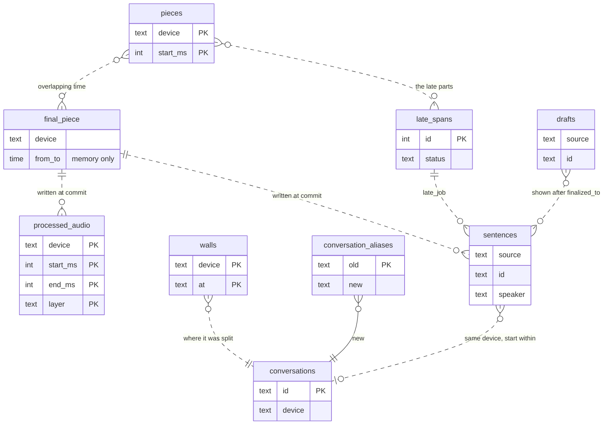
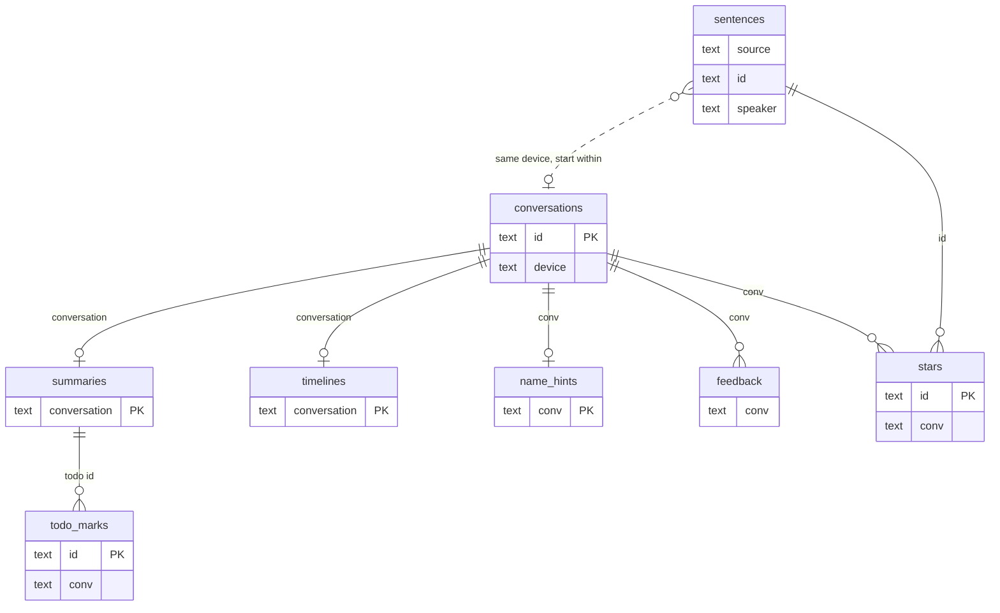
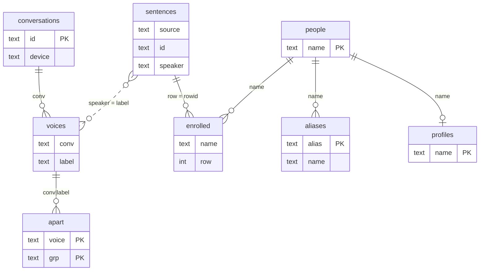
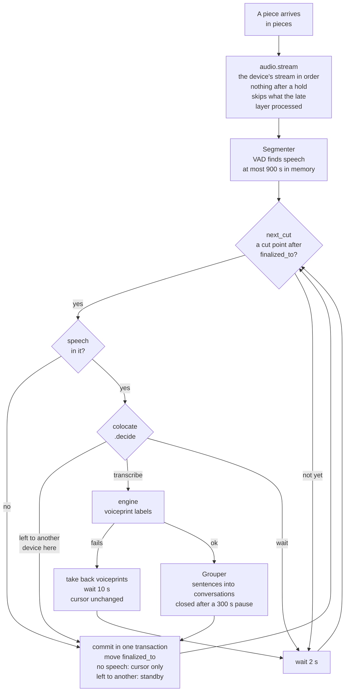
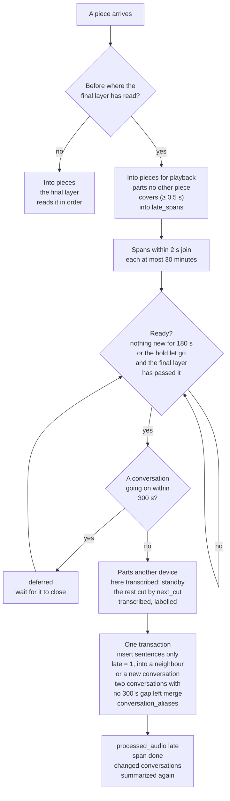

# Domain model: pieces, sentences and conversations

This page explains which objects the server keeps, how they relate, and how the processing loop moves forward. For the parts of the system and how audio comes in, see [Architecture and data flow](./architecture.md). For what each table holds, see [Data layout](../reference/data.md).

Every fact on this page comes from the code in `server/alldayrec/`. File names are in brackets.

## Two kinds of piece

The code uses "piece" for two different things. They do not map to each other.

| | Uploaded piece | Final piece |
|---|---|---|
| What it is | One audio file a client uploads | One stretch of audio the final layer sends to the ASR engine at once |
| Who cuts it | The client. The app cuts 1 s pieces in the foreground, 20 s in the background and 60 s with the Android screen off; while a page watches the live view, background and screen-off pieces are at most 2 s (`SLICE_*_S` in `routes_upload.py`). An imported recording file is one piece too | The server, in a pause (`next_cut` in `segmenter.py`), at most 300 s (`CHUNK_S`) |
| Where it is kept | Its bytes are appended unchanged to the device's file for that hour, indexed in the `pieces` table (`audio.py`) | Only in memory, which holds at most 900 s of audio (`BUFFER_S`). After it is processed, only its coverage rows in `processed_audio` and one line of raw engine output in `<date>.passes.jsonl` remain |
| Unique key | `(device, start_ms)` | None |

The server joins a device's uploaded pieces into one time-ordered audio stream (`audio.stream`). The final layer finds its own cut points on that stream. So one final piece can span dozens of uploaded pieces, and one long imported piece becomes many final pieces.

## Objects

Almost every object carries a device (`device` or `source`) and a time range. The four tables below group the objects by audio, text, AI and people. Each row gives what the object is, its unique key, where it is stored, who creates it, who changes it, and when it ends.

### Audio

| Object | What it is | Unique key | Stored in | Created by | Changed by | Lifecycle |
|---|---|---|---|---|---|---|
| Uploaded piece | The audio of one upload | `(device, start_ms)` | `pieces` table + `recordings/chunks/<device>/<date>/<HH>.<ext>` | `POST /api/chunks` (`audio.save`, `audio.save_file`) | A longer copy with the same device and start replaces the row; a copy as long or shorter does not | Server code never deletes it |
| Final piece | Audio the final layer sends to the engine at once | None | Memory | `final_piece` in `device_pipeline.py` | — | Dropped from memory after its commit |
| Processed coverage | A time range a layer has processed, pauses included | `(device, start_ms, end_ms, layer)` | `processed_audio` | A final piece's commit (`final` or `standby`); a late span's commit (`late`, and `standby` for the parts another device in the same place has) | When a device stops standing by, its `standby` rows of the last 300 s are deleted and that audio goes to the late layer (`colocate.resume`) | Kept |
| Late span | Audio that arrived after the final layer had read past its time | `id` | `late_spans` | An upload found late (`late_store.record`); a device that stops standing by (`colocate.resume`); a historical scan (`late_backfill.py`) | The late processor: splits it, sets its status, counts tries | `waiting` → `processing` → `done`, or `deferred`, `failed` (a retry, `late_store.requeue`: back to `waiting`) |
| Device progress | Each device's cursors and flags | Key name | `kv` table | The pipeline and the upload endpoints | Same | See [The processing loop](#the-processing-loop) |

The `kv` keys for a device `<d>`:

| Key | Meaning | Written by |
|---|---|---|
| `finalized_to:<d>` | Where the final layer has finalized to (to the µs) | `commit` in `device_pipeline.py` |
| `open_conversation:<d>` | The conversation going on, with its sentences | `commit` |
| `draft_to:<d>` | Where the draft layer has drafted to | `publish_drafts`, `draft_pass` |
| `live:<d>` | The live analysis of the conversation going on | `live_update`; cleared when the conversation closes |
| `read_to:<d>`, `read_end:<d>` | Start and end of the last piece the final reader took | `audio.stream` |
| `hold:<d>` | The phone has older audio still to send; the final layer waits at this time | `audio.hold`, `audio.held` |
| `end_at:<d>` | When the recorder stopped | `POST /api/chunks/end` |
| `standby:<d>` | Which device this device stands by for, and from when (`since`) | `colocate.decide`, `colocate.take` |

### Text

| Object | What it is | Unique key | Stored in | Created by | Changed by | Lifecycle |
|---|---|---|---|---|---|---|
| Sentence | One final sentence: time, speaker, text | `(source, id)`. `id` is `f` plus its start time to the ms, so two devices that start a sentence in the same ms share an `id`. The table has no primary key; `enrolled` and the rename undo use SQLite's `rowid` | `sentences` | A final piece's commit (`db.replace_sentences`); a late span's commit (insert only, `late = 1`) | Only the speaker: relabelling the whole conversation at its close (`relabel_rows`), renames, a single sentence's speaker, label matching in late merges. Server code never changes the text | Kept |
| Draft sentence | A sentence of the draft layer | `id` is `d` plus its start time | `drafts` | The draft layer | — | Pages stop showing it once final rows cover its time; it stays in the table |
| Conversation | Sentences grouped by pauses | `id` is `c` plus its start time (`cYYYYMMDDHHMMSS`), with the device name added when another device's conversation started in the same second | Going on: `open_conversation:<d>` in `kv`; closed: `conversations` | `commit`, when the `Grouper` (`conversations.py`) closes it; the late layer; a split's later parts (`split.py`) | Renames change `participants`; late merges change its start, end, sentence count and speech seconds | Deleted when merged into another or when a split is undone, leaving a `conversation_aliases` row |
| Conversation alias | A merged conversation's `id` pointing to the one kept, with a map of speaker labels | `old` | `conversation_aliases` | `late_merge.merge` (late audio joins two conversations, or a split is undone) | — | Kept: old links resolve through it (`db.resolve_conversation`) |
| Wall | Where a long conversation was split; late audio never merges across it | `(device, at)` | `walls` | `split.py` | Deleted when the split is undone | — |

### AI

| Object | What it is | Unique key | Stored in | Created by | Changed by | Lifecycle |
|---|---|---|---|---|---|---|
| Live analysis | A topic timeline of the conversation going on, kept by one multi-turn agent | Device | Going on: `live:<d>` in `kv`; at the close: `timelines` | `live_update` in `device_pipeline.py` (`live.py`) | Redone after every 120 s of new speech (`LIVE_EVERY_S`) | Saved into `timelines` when the conversation closes; the `kv` key is cleared |
| Summary | A conversation's title, summary, points, todos, decisions and tags | `conversation` | `summaries` (`body` is JSON) | A `pending` row when the conversation closes (`commit`); the summary workers write it (`summaries.py`) | Rewritten after a rename, a speaker correction or a late merge | `pending` → `done` or `failed` |
| Todo | One todo in a summary | The conversation `id` plus the time it was said, with `#2`, `#3` for later ones at the same time; `preserve_todos` keeps the old `id` when the summary is written again | `todos` in `summaries.body`; no table of its own | The summary | A new summary | With its summary |
| Todo mark | 完成 (done) or 不对 (wrong) on a todo | The todo's `id` | `todo_marks` | The web pages | Deleting the row is the undo | — |
| Star | A starred sentence | The sentence's `id` | `stars`, with its conversation in `conv` | The web pages | Splits and merges change `conv` | Deleted when unstarred |
| Feedback | What the user says a summary got wrong | None | `feedback` | The web pages | — | Kept; read when summaries are written |
| Name hints | What each label was called in a conversation; only for suggesting names | `conv` | `name_hints` | After a summary is done (`hints.py`) | Follows a rename | — |
| Profile | A named person's profile, each line with its sources | `name` | `profiles` | The person page (`profiles.py`) | Updated after a summary of a conversation the person took part in | — |
| Daily recap | The recap of the day before | Date | `recap:<date>` in `kv` | `summaries.py` | Marked stale when late audio changes a conversation of that day | — |

### People

| Object | What it is | Unique key | Stored in | Created by | Changed by | Lifecycle |
|---|---|---|---|---|---|---|
| Speaker label | Who said a sentence: 我 (me), a name, `S1` `S2`…, or `S?` (too short, or music) | — | `sentences.speaker` | Voiceprint clustering at finalization (`diarist.py`, `label_sentences` in `transcript.py`) | See [Speaker labels](#speaker-labels) | With its sentence |
| Voice | One label of one conversation: its mean voiceprint and a sample clip | `(conv, label)`, written `conv\|label` elsewhere | `voices` | Every 5 minutes for conversations closed in the last 3 days (`voices_loop` in `routes_voices.py`); the late layer | Follows its label on a rename | — |
| Apart pin | A voice marked as not belonging to a group | `(voice, grp)` | `apart` | 不是 (not this person) and 拆开 (split) on the person page | Follows renames and merges | — |
| Person | A named person's voiceprints: up to 5 samples, the nearest one names a cluster | `name` | `people` (the mean), `people_samples` | The first sentence learnt for the name | Remade from `enrolled` after each sentence learnt or taken back: one sample per conversation, the most alike merged down to 5 (`bank.py`) | — |
| Enrolled sentence | Which sentence taught a person's voiceprint, one row each | None; `row` is the sentence's `rowid` | `enrolled` | Learning after a rename (`enroll`) | Rows are deleted when a rename moves the sentences away or is undone | — |
| Alias | Another name for a person | `alias` | `aliases` | The web pages | — | — |
| My voiceprint | The person who records | — | `owner-redimnet2.npz` in the data directory | The 哪个是你 (which one is you) card, a yes on the 这是你吗 (is this you) card, or renaming a label to 我 | Same | — |

## Relationships

### By device and time

The core rule: objects relate by "same device, overlapping time". The schema in `db.py` has no `FOREIGN KEY` at all. Where an object refers to another by `id`, it only stores the value; the code keeps them consistent by changing them in one transaction.

- **Which conversation a sentence belongs to** is not stored on the sentence. `conversation_rows` in `core.py` looks it up each time: the sentences of the conversation's device whose start lies within its start and end, both included. When a conversation's start or end changes, its sentences change with it.
- **The `Grouper` cuts conversations** (`conversations.py`). It takes final sentences in time order. It closes the open conversation after a 300 s pause between sentences (`GAP_S`), after 4 hours (`MAX_S`), when the recorder stops, or after 20 minutes with no event at all (`IDLE_S`, the safety net). A conversation with less than 10 s of speech (`MIN_S`) is dropped; its sentences stay. Sentences labelled `S?` or 远处 (far away) and the like belong to the conversation but neither extend it nor count as speech.
- **Final pieces and conversations are many to many.** One final piece's sentences can close a conversation and start the next. One long conversation spans many final pieces.
- **Uploaded pieces and sentences relate by time only.** To play a sentence, the server cuts its audio from the pieces by its device and times (`audio.cut`).

### By key

- **A summary and a live analysis each belong to one conversation.** `summaries` and `timelines` both use the conversation `id` as their primary key. A live analysis exists only while a page watches, so a conversation has 0 or 1.
- **A todo mark points to a todo in a summary**, not to a sentence. A todo's `id` joins the conversation `id` and the time it was said. When a summary is written again, `db.preserve_todos` matches each old todo uniquely by its text (else its quote), owner and recipient, and pins the old `id` on the new todo. A marked old todo that matches none stays as it was.
- **A star points to a sentence `id`**, with its conversation. Reading stars finds the sentence by that `id`, on the conversation's device, within the conversation's time (`routes_sentences.py`).
- **A voice points to a conversation and a label**; `apart` points to a voice; `enrolled` points to a sentence's `rowid` and a name.

### Rewriting sentences is where things break

A sentence's `id` comes from its start time and its `rowid` from the order of inserts. Speaker changes touch neither: relabelling, renames and merges all `UPDATE` the speaker. What breaks them is deleting and writing again. `db.replace_sentences` deletes the device's non-late sentences in a time range and inserts new ones. In normal running each final piece is written once. Existing sentences are written again only when `finalized_to` is moved back to replay audio already final. After that:

- A new sentence starts at a slightly different time, so its `id` differs. The star cannot find its sentence and drops out of the starred list (the comment on `/api/stars` says so).
- A new sentence has a new `rowid`. The `enrolled` row now points to a sentence that no longer exists, and the in-memory rename undo holds `rowid`s that no longer match.

Sentences the late layer inserts carry `late = 1`. `replace_sentences` never deletes them, and never inserts a new sentence that overlaps one.

### Speaker labels

1. **Numbered within a conversation at finalization.** Each device's final layer has a `Diarist`. With each new sentence it clusters the open conversation's voiceprints again. A cluster whose mean is close to my voiceprint is labelled 我; close to a person in `people`, that person's name; otherwise `S<n>`. A sentence shorter than 0.3 s or heard as music is `S?`. When a conversation closes, the `Diarist` is reset and the next conversation starts again at `S1`. So `S1` means something only within one conversation.
2. **Relabelled as a whole when the conversation closes.** `relabel_rows` clusters the whole conversation's voiceprints again and changes the labels that differ, before the conversation is written to `conversations`.
3. **Then renamed by a person.** A rename (`POST /api/conversation/{id}/rename`) changes, in one transaction, the label's sentences in that conversation, `participants`, the voice, `apart` and the name hints, then redoes the summary. When the new name is a person's name, up to 20 of those sentences are learnt into `people`, each recorded as a row in `enrolled`. Every `Diarist` of the tenant gets the new voiceprint at once, so later conversations recognize that person. A name typed on the pages is checked first (`check`): when the name is in use already, or the voice sounds like another named person, the page asks whether to merge or start a new person. The answer of a rename lists the earlier conversations where the same voice is still unnamed (`also`); 「一起改」 (rename them too) names those as the speakers page does (`POST /api/speakers/name`). When that card sounds like two people, only the voices of this one's half are listed; one undo takes back both the rename and 「一起改」.

A rename writes no table of renames. Its undo is a snapshot of the 20 latest renames in memory (`UNDO_KEEP`), lost on a server restart. What persists is the sentences learnt in `enrolled`. `conversation_aliases` records merged conversations, not renames.

### Diagrams

In the three diagrams below, a solid line is a stored key. A dashed line is a lookup by device and time, with no key stored.

#### Audio and text

#### AI and references on a conversation

#### People

## Layers

The server runs three transcription layers over one audio stream and two AI layers over conversations.

| Layer | When it runs | Reads | Writes |
|---|---|---|---|
| Final | Always, per device (`final_loop` in `device_pipeline.py`) | The device's stream from `finalized_to`, without what lies after a `hold` or what the late layer has processed | `sentences`, `processed_audio` (`final`), `conversations`, `summaries` (`pending`), `timelines`; `finalized_to`, `open_conversation`, `live` in `kv` |
| └ Standby | A branch of the final layer: another device of the tenant records the same sound in the same place (their levels rise and fall together, `colocate.py`) | The level envelopes of both devices' pieces (`pieces.env`) | Only `processed_audio` (`standby`), and `finalized_to` moves on. No engine call, no sentences, conversations, drafts or live analysis. Of the two, the one that hears better transcribes and the other stands by (`colocate.quality`: how many dB its speech is above its floor, less for speech too quiet, missing frames and clipping). It transcribes again when the other device sends no audio for 90 s or the two stop correlating; in the second case, what it left to the other in the last 300 s goes to the late layer. A standby that hears better by 6 dB or more in each of the last two 300 s windows takes over, and the other stands by. A device that just started waits, up to 180 s after the piece, for a window to be judged on |
| Draft | A page watches, the device had new audio in the last 120 s, and it is not standing by (`drafting`) | The device's newest 300 s of audio (`edge_feed`, skipping any backlog) | `drafts`; `draft_to` in `kv` |
| Late | One serial processor per tenant (`processor` in `late.py`) | `late_spans`; pieces read at exact times (`read_exact`) | `sentences` (`late = 1`), new or merged `conversations`, `voices`, `conversation_aliases`, `processed_audio` (`late` or `standby`), `summaries` (written again) |
| Live analysis | A page is in front, the conversation going on has 60 s of speech, then after every 120 s of new speech; or 立即总结 (summarize now) is pressed | The open conversation's final sentences plus drafts (`open_view`) | `live:<d>` in `kv`; `timelines` when the conversation closes |
| Summary | Queued when a conversation closes; 4 workers (`SUMMARY_WORKERS`) | `conversation_rows`; when a live analysis exists, its agent writes the final summary | `summaries`; then `name_hints`, and `profiles` that already exist |

Before a conversation of at least 10 minutes (`SPLIT_MIN_S`) is summarized, `split.py` checks whether to split it. On a split, the first part keeps the `id`; each later part becomes a new conversation with a row in `walls`, and each part is queued for its own summary. A conversation with less than 60 s of speech gets no LLM call; its title is its first sentence (`summary.py`).

## The processing loop

The final layer is not a state machine with fixed states. It is one cursor and one loop: everything before `finalized_to` is final, and each turn of the loop cuts the next stretch after the cursor, processes it, commits it and moves the cursor.

### Cut points

`next_cut` in `segmenter.py` looks after `finalized_to`, in this order:

1. At the first silence of 30 s (`QUIET_S`; leading and trailing silence count), it cuts 15 s into that silence.
2. Without one, once 300 s of audio is there (`CHUNK_S`), it cuts in the middle of the widest pause in the last 60 s (`CUT_SEARCH_S`). With no pause at all, it cuts at 300 s.
3. When the recorder has stopped (`end_at:<d>`) and all its audio is in the stream, it cuts at the end of the audio, even in speech.
4. Otherwise it returns nothing and waits for more audio.

Except in case 3, every cut lies in silence or at exactly 300 s, so the engine always hears the end of a sentence.

### One transaction per commit

`commit` writes one final piece's results in one transaction: the sentences that replace its time, its `processed_audio`, the conversations it closed with their `pending` summaries and live timelines, the new `finalized_to`, and `open_conversation`. All of it is written, or none. Summaries are queued and pages are told only after the commit.

### Retries

- **The engine call fails:** `ENGINE_FALLBACK` is tried first, when set (`asr.py`). If that fails too, the voiceprints this piece added to the `Diarist` are taken back, the loop waits 10 s, and `finalized_to` stays. The next turn cuts again from the same place.
- **The pipeline raises:** `lasting` in `server.py` starts it again from `finalized_to` 60 s later (`RESTART_S`), as after a server restart.
- **Decoding fails:** after 3 failures in a row on a long file, the device's stream stops and the pages ask you to check the file and restart the server (`audio.stream`).
- **A summary fails:** it is tried again after 10, 60 and 300 s. If all fail, it is `failed`; an existing summary is kept.
- **A late span fails:** it is tried again after 30 s, then 60 s. The third failure makes it `failed` (`late_store.failed`).

### Resuming after a restart

Progress kept in the store resumes. State kept only in memory is rebuilt:

| State | Kept in | After a restart |
|---|---|---|
| Where finalization is | `finalized_to:<d>` | The stream is read again from the piece holding that time |
| The conversation going on | `open_conversation:<d>` | The `Grouper` continues it |
| Drafts, live analysis | `draft_to:<d>`, `live:<d>` | Used again |
| A late span being processed | `processing` in `late_spans` | Back to `waiting` with its try count kept; one with 3 tries becomes `failed` (`late_store.recover`). One waiting for the infer service is already back to `waiting` at the stop, that try given back, at most 3 times a span (`late_store.stopped`) |
| Summaries not written | `pending` in `summaries` | Queued again when the summary workers start |
| Audio, VAD and voiceprint clusters | Memory | Fed again from `finalized_to`. The earlier voiceprints are gone, so relabelling the whole conversation at its close may be skipped |
| Rename undo | Memory | Lost |

`finalized_to` is stored to the µs so that a restart does not send the last few samples to the engine again as not yet final.

### Hold: waiting for a backlog

A phone may upload what is said now while it reads older audio off the recorder's card from a time they were apart. Each upload then carries `hold=<unix ms>`: "there is still audio before this time to send". The final layer stops at that time and waits; the draft layer does not (`audio.hold`, `audio.held`).

It stops waiting when any of these happens:

- An upload comes without `hold`, or the phone calls `POST /api/hold/release`.
- The phone keeps saying hold, but no older audio arrives for 20 minutes (`HOLD_STALE_S`).
- 12 hours pass since the hold was first said (`HOLD_MAX_S`).
- `finalized_to` is already past that time.

Older audio that arrives after that is late audio.

### How late audio is routed

The late layer only inserts sentences and never replaces any: it skips a sentence that overlaps an existing one or whose `id` exists. When two conversations merge, the later one's anonymous labels are matched to the earlier one's by voiceprint. The references in stars, feedback, todos and their marks, voices, enrolled sentences, name hints, the live timeline, profiles and recaps move in the same transaction (`late_merge.merge`). Conversations never merge across a wall.

## Related pages

- [Architecture and data flow](./architecture.md): the parts, how audio comes in, where each engine's speakers come from.
- [Data layout](../reference/data.md): what each table and file holds.
- [Configuration](../reference/configuration.md): which values on this page environment variables can change.
