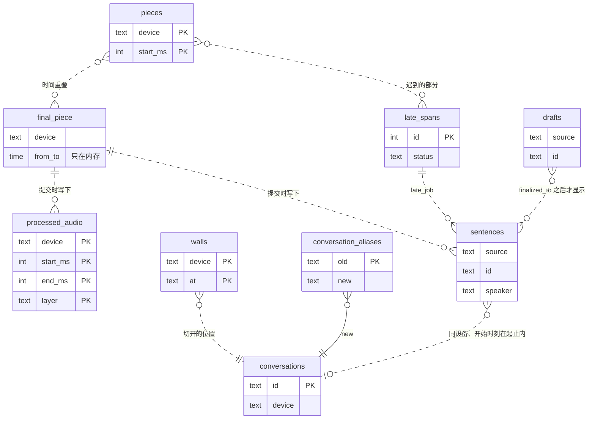
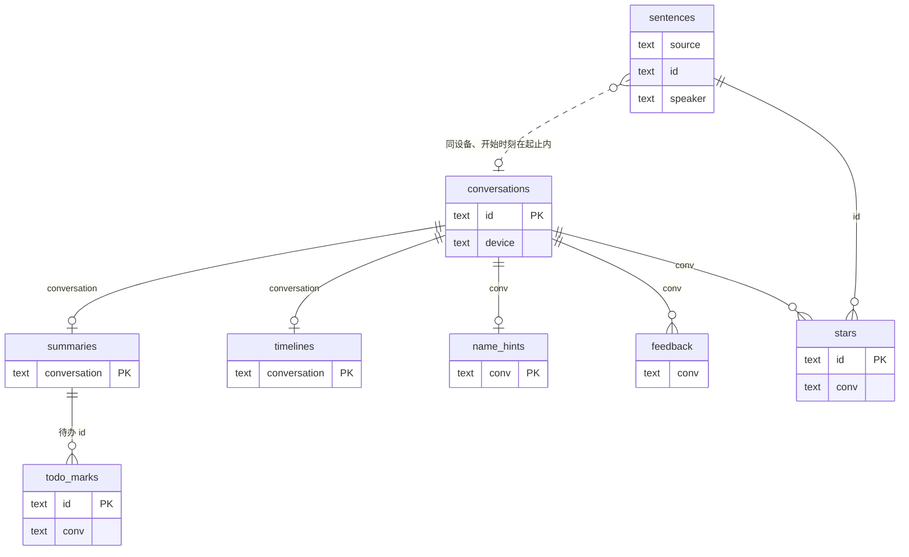
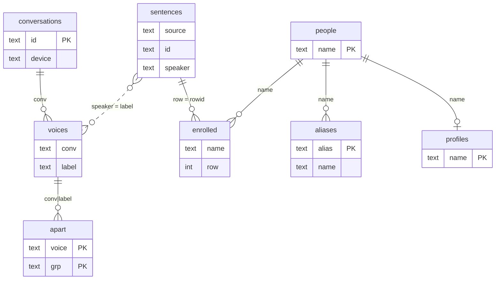
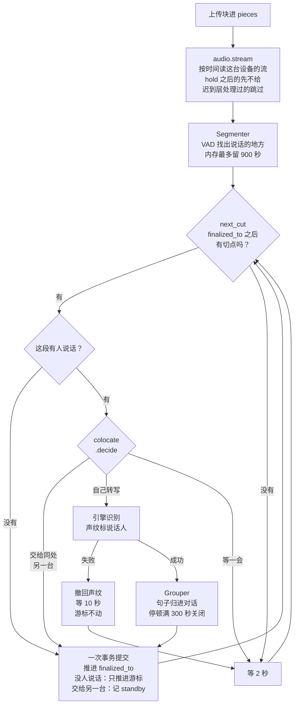
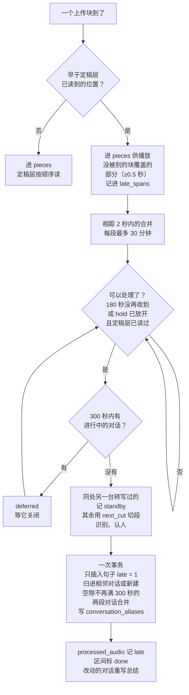

# 领域模型：块、句子和对话

本页讲服务器里有哪些对象、它们之间是什么关系、处理循环怎样推进。组成部分和音频怎么进来见[架构与数据流](./architecture.md)；每张表存什么见[数据目录](../reference/data.md)。

本页的每个事实都来自 `server/alldayrec/` 下的代码，括号里写出文件名。

## 两种「块」

「块」这个词在代码里指两样东西，它们之间没有对应关系。

| | 上传块（piece） | 定稿段（final piece） |
|---|---|---|
| 是什么 | 客户端上传的一个音频文件 | 定稿层一次送给语音识别引擎的一段音频 |
| 谁切的 | 客户端。App 在前台每块 1 秒，后台 20 秒，安卓熄屏 60 秒；有网页在看实时页时，后台和熄屏都不超过 2 秒（`routes_upload.py` 的 `SLICE_*_S`）。导入的整段录音文件也是一个块 | 服务器，在停顿处切（`segmenter.py` 的 `next_cut`），最长 300 秒（`CHUNK_S`） |
| 存在哪 | 字节原样追加到这台设备这个小时的文件里，索引在 `pieces` 表（`audio.py`） | 只在内存里，最多保留 900 秒音频（`BUFFER_S`）。处理完只留下 `processed_audio` 里的覆盖记录和 `<日期>.passes.jsonl` 里的一行引擎原始输出 |
| 唯一键 | `(device, start_ms)` | 没有 |

服务器把一台设备的所有上传块拼成一条按时间排好的音频流（`audio.stream`），定稿层在这条流上自己找切点。所以一个定稿段可以跨几十个上传块，一个长的导入块也会被切成很多个定稿段。

## 对象

几乎所有对象都带一台设备（`device` 或 `source`）和一个时间范围。下面四张表按音频、文字、AI、人分组，列出每个对象是什么、唯一键、存在哪、谁创建、谁修改、什么时候结束。

### 音频侧

| 对象 | 是什么 | 唯一键 | 存在哪 | 谁创建 | 谁修改 | 生命周期 |
|---|---|---|---|---|---|---|
| 上传块 | 一次上传的音频 | `(device, start_ms)` | `pieces` 表 + `recordings/chunks/<设备>/<日期>/<HH>.<扩展名>` | `POST /api/chunks`（`audio.save`、`audio.save_file`） | 同一设备、同一开始时刻再传一次更长的，替换这一行；一样长或更短的不替换 | 服务端代码不删除 |
| 定稿段 | 定稿层一次送给引擎的音频 | 无 | 内存 | `device_pipeline.py` 的 `final_piece` | — | 提交后从内存里丢掉 |
| 处理覆盖 | 某层已经处理过的一段时间，含停顿 | `(device, start_ms, end_ms, layer)` | `processed_audio` | 定稿段提交（`final` 或 `standby`），迟到区间提交（`late`，留给同处另一台的部分记 `standby`） | 一台设备从备用转回转写时，删掉之前 300 秒的 `standby` 记录，把那段交给迟到层（`colocate.resume`） | 一直保留 |
| 迟到区间 | 到得太晚、定稿层已经读过去的一段音频 | `id` | `late_spans` | 上传时判定为迟到（`late_store.record`）；备用转回（`colocate.resume`）；历史补扫（`late_backfill.py`） | 迟到处理器：拆分、改状态、记重试 | `waiting` → `processing` → `done`，或 `deferred`、`failed`（重试：`late_store.requeue`，回到 `waiting`） |
| 设备进度 | 每台设备的游标和标志 | 键名 | `kv` 表 | 处理流程、上传接口 | 同左 | 见下文[处理循环](#处理循环) |

`kv` 里和一台设备 `<d>` 有关的键：

| 键 | 含义 | 写入的代码 |
|---|---|---|
| `finalized_to:<d>` | 定稿层处理到的时刻（到微秒） | `device_pipeline.py` 的 `commit` |
| `open_conversation:<d>` | 正在进行的对话，连同它的句子 | `commit` |
| `draft_to:<d>` | 草稿层出到的时刻 | `publish_drafts`、`draft_pass` |
| `live:<d>` | 正在进行的对话的实时分析 | `live_update`；对话结束时清空 |
| `read_to:<d>`、`read_end:<d>` | 定稿层的读取器拿到的最后一块的开始和结束 | `audio.stream` |
| `hold:<d>` | 手机说还有更早的音频要补传，定稿层在这一刻前等着 | `audio.hold`、`audio.held` |
| `end_at:<d>` | 录音设备停录的时刻 | `POST /api/chunks/end` |
| `standby:<d>` | 这台设备在给哪台设备当备用 | `colocate.decide` |

### 文字侧

| 对象 | 是什么 | 唯一键 | 存在哪 | 谁创建 | 谁修改 | 生命周期 |
|---|---|---|---|---|---|---|
| 句子 | 定稿的一句话：时间、说话人、文字 | `(source, id)`。`id` 是 `f` 加开始时刻（到毫秒），两台设备同一毫秒开口会同 `id`。表上没有主键约束，`enrolled` 和改名撤销用的是 SQLite 的 `rowid` | `sentences` | 定稿段提交（`db.replace_sentences`）；迟到区间提交（只插入，`late = 1`） | 只改说话人：对话结束时整段重新认人（`relabel_rows`）、改名、单句改人、迟到合并时的标签对齐。服务端代码不改文字 | 一直保留 |
| 草稿句子 | 草稿层出的句子 | `id` 是 `d` 加开始时刻 | `drafts` | 草稿层 | — | 定稿覆盖这段时间后页面不再显示，表里仍保留 |
| 对话 | 一段按停顿归在一起的句子 | `id` 是 `c` 加开始时刻（`cYYYYMMDDHHMMSS`），同一秒撞上别的设备时加设备名后缀 | 进行中：`kv` 的 `open_conversation:<d>`；结束后：`conversations` | `Grouper`（`conversations.py`）关闭时由 `commit` 写入；迟到层新建；长对话切开时，后面几段新建（`split.py`） | 改名改 `participants`；迟到合并改起止、句数、说话秒数 | 被合并或撤销切分时删除，留下一条 `conversation_aliases` |
| 对话别名 | 被合并掉的对话 `id` 指向保留的对话，连同说话人标签的映射 | `old` | `conversation_aliases` | `late_merge.merge`（迟到音频把两段连起来，或撤销切分） | — | 一直保留：旧链接靠它跳到新对话（`db.resolve_conversation`） |
| 分界 | 长对话被切开的位置，迟到音频不会跨它合并 | `(device, at)` | `walls` | `split.py` | 撤销切分时删除 | — |

### AI 侧

| 对象 | 是什么 | 唯一键 | 存在哪 | 谁创建 | 谁修改 | 生命周期 |
|---|---|---|---|---|---|---|
| 实时分析 | 进行中对话的议题时间线，一个多轮对话的 Agent 维护 | 设备 | 进行中：`kv` 的 `live:<d>`；对话结束时：`timelines` | `device_pipeline.py` 的 `live_update`（`live.py`） | 每多 120 秒新语音重算一次（`LIVE_EVERY_S`） | 对话结束时存进 `timelines`，`kv` 清空 |
| 总结 | 对话的标题、摘要、要点、待办、决定、标签 | `conversation` | `summaries`（`body` 是 JSON） | 对话关闭时写一行 `pending`（`commit`），总结 worker 生成（`summaries.py`） | 改名、改人、迟到合并后重写 | `pending` → `done` 或 `failed` |
| 待办 | 总结里的一条待办 | 对话 `id` 加说出它的时刻，同一时刻第二条起加 `#2`、`#3`；重新生成后靠 `preserve_todos` 保住原 `id` | `summaries.body` 的 `todos`，没有单独的表 | 总结 | 重新生成总结 | 随总结 |
| 待办标记 | 待办上的「完成」或「不对」 | 待办 `id` | `todo_marks` | 网页 | 删除这一行就是撤销 | — |
| 收藏 | 收藏的一句话 | 句子 `id` | `stars`，另记所在对话 `conv` | 网页 | 切分、合并时改 `conv` | 取消收藏时删除 |
| 反馈 | 用户说总结哪里错了 | 无 | `feedback` | 网页 | — | 一直保留，写下一次总结时读 |
| 称呼线索 | 每个标签在对话里被怎么称呼，只用于建议名字 | `conv` | `name_hints` | 总结完成后（`hints.py`） | 改名时跟着改 | — |
| 人物卡片 | 一个有名字的人的介绍，每行带出处 | `name` | `profiles` | 人物页（`profiles.py`） | 这个人参加的对话总结完成后更新 | — |
| 每日回顾 | 前一天的回顾 | 日期 | `kv` 的 `recap:<日期>` | `summaries.py` | 迟到音频改动那天的对话后标为过时 | — |

### 人侧

| 对象 | 是什么 | 唯一键 | 存在哪 | 谁创建 | 谁修改 | 生命周期 |
|---|---|---|---|---|---|---|
| 说话人标签 | 一句话是谁说的：「我」、人名、`S1` `S2`…，或 `S?`（太短或音乐） | — | `sentences.speaker` | 定稿时由声纹聚类给出（`diarist.py`、`transcript.py` 的 `label_sentences`） | 见下文[说话人标签](#说话人标签) | 随句子 |
| 声音 | 一段对话里一个标签的平均声纹和一段示例音频 | `(conv, label)`，别处写成 `conv\|label` | `voices` | 每 5 分钟给最近 3 天结束的对话补算（`routes_voices.py` 的 `voices_loop`）；迟到层 | 改名时跟着标签走 | — |
| 不是这个人 | 一个声音被标成「不属于这一组」 | `(voice, grp)` | `apart` | 人物页的「不是」「拆开」 | 改名、合并时跟着改 | — |
| 人 | 一个有名字的人的声纹：最多 5 个样本，聚类跟最近的那个比 | `name` | `people`（均值）、`people_samples` | 第一次有句子学进这个名字 | 每学一句或撤一句，从 `enrolled` 重新生成：每段对话一个样本，最像的两两合并，直到剩 5 个（`bank.py`） | — |
| 声纹来源 | 一个人的声纹是从哪句学来的，一句一行 | 无；`row` 是句子的 `rowid` | `enrolled` | 改名后学声纹（`enroll`） | 改走、撤销时删掉对应行 | — |
| 别名 | 一个人的另一个称呼 | `alias` | `aliases` | 网页 | — | — |
| 「我」的声纹 | 录音者本人 | — | data 目录下的 `owner-redimnet2.npz` | 「哪个是你」卡片、「这是你吗」卡片，或把标签改成「我」 | 同左 | — |

## 关系

### 按设备和时间关联

核心规则：对象之间靠「同一台设备、时间重叠」关联。`db.py` 的建表语句里没有一条 `FOREIGN KEY`，有 `id` 的引用也只是存了对方的值，一致性靠代码在同一个事务里一起改。

- **句子属于哪个对话**，不存在句子上。`core.py` 的 `conversation_rows` 每次现查：这个对话的设备上、开始时刻在对话起止之间（含两端）的句子。所以改了对话的起止，它包含的句子就跟着变。
- **对话由 `Grouper` 切出来**（`conversations.py`）。它按时间顺序吃定稿句子：和上一句之间停顿满 300 秒（`GAP_S`）、对话满 4 小时（`MAX_S`）、录音设备停录，或者 20 分钟没有任何事件（`IDLE_S`，兜底），就关闭当前对话。说话不到 10 秒（`MIN_S`）的对话直接丢掉，句子还在。`S?` 和「远处」这类标签的句子算进对话，但不延长它，也不算说话时长。
- **定稿段和对话是多对多**。一个定稿段的句子可以先关掉一个对话、再开始下一个；一个长对话跨很多个定稿段。
- **上传块和句子也只按时间对应**。播放一句话时，服务器按它的设备和起止时刻从上传块里现切音频（`audio.cut`）。

### 按键关联

- **总结、实时分析和对话一对一**：`summaries` 和 `timelines` 都以对话 `id` 为主键。实时分析只在有网页看着时才有，所以一个对话有 0 或 1 个。
- **待办标记指向总结里的待办**，不指向句子。待办 `id` 由对话 `id` 和说出它的时刻拼成；重新生成总结时，`db.preserve_todos` 按文字（或原话）、负责人和对象唯一匹配，把旧 `id` 钉到新待办上，匹配不上但已标记的旧待办原样保留。
- **收藏指向句子 `id`**，另存所在对话。查收藏时按「这个 `id`、在这个对话的设备上、在这个对话的时间里」找句子（`routes_sentences.py`）。
- **声音指向「对话 + 标签」**，`apart` 指向声音，`enrolled` 指向句子的 `rowid` 和人名。

### 重写句子时最容易出问题

句子的 `id` 由开始时刻生成，`rowid` 由插入顺序生成。说话人怎么改都不动这两样：重新认人、改名、合并都是 `UPDATE` 说话人。会出问题的是删掉重写：`db.replace_sentences` 先删掉一段时间里这台设备的非迟到句子，再插入新的。正常运行时每个定稿段只写一次；只有把 `finalized_to` 往回调、重放已经定稿的音频，才会重写已有的句子。重写后：

- 新句子的开始时刻稍有不同，`id` 就变了，收藏找不到原句，从收藏列表里消失（`/api/stars` 的注释写明了这一点）。
- 新句子有新的 `rowid`，`enrolled` 里那一行指向的句子不存在了，内存里改名撤销记的 `rowid` 也失效。

迟到层插入的句子标了 `late = 1`，`replace_sentences` 不删它们，也不插入和它们时间重叠的新句子。

### 说话人标签

1. **定稿时在对话内编号**。每台设备的定稿层有一个 `Diarist`，每来一句就把当前对话的声纹重新聚类：聚类的平均声纹接近「我」的声纹，标「我」；接近 `people` 里某个人，标这个人的名字；否则标 `S<n>`。短于 0.3 秒或听成音乐的标 `S?`。对话关闭时，`Diarist` 清空，下一个对话从 `S1` 重新编号。所以 `S1` 只在一段对话里有意义。
2. **对话关闭时整段重新认人**。`relabel_rows` 拿整段的声纹再分一次，改掉不一致的标签，然后才写进 `conversations`。
3. **之后由人改名**。改名（`POST /api/conversation/{id}/rename`）在一个事务里改这个对话里这个标签的句子、`participants`、声音、`apart` 和称呼线索，然后重写总结。新名字是人名时，再从这些句子里挑最多 20 句学进 `people`，每句在 `enrolled` 记一行；同一租户所有设备的 `Diarist` 也立刻学到，后面的对话直接认出这个人。网页上手打的名字先查重（`check`）：已有同名的人，或这个声音的声纹很像另一个已命名的人，先问是合并还是新建；改名后回答里带上之前还没命名、听着是同一个声音的对话（`also`），点「一起改」就按人物页的命名（`POST /api/speakers/name`）一起改掉。那张卡听着像两个人时只带上和这段同一半的声音；一次撤销连同这次改名一起改回。

改名不另写一张改名记录表。撤销靠内存里最近 20 次改名的快照（`UNDO_KEEP`），服务器重启后就没有了；持久留下的痕迹是 `enrolled` 里学到的句子。`conversation_aliases` 记的是对话合并，不是改名。

### 关系图

下面三张图里，实线是存了对方的键；虚线是按设备和时间现查，没有存键。

#### 音频和文字

#### 对话上的 AI 和引用

#### 人

## 层

服务器在同一条音频流上跑三层转写，在对话上跑两层 AI。

| 层 | 什么时候跑 | 读 | 写 |
|---|---|---|---|
| 定稿层 | 每台设备一直跑（`device_pipeline.py` 的 `final_loop`） | 设备的音频流：从 `finalized_to` 起，跳过 `hold` 之后的和迟到层已处理的 | `sentences`、`processed_audio`（`final`）、`conversations`、`summaries`（`pending`）、`timelines`；`kv` 的 `finalized_to`、`open_conversation`、`live` |
| └ 备用（standby） | 定稿层里的一个分支：同一租户另一台设备在同一处录着同样的声音（两台的音量起伏相关，`colocate.py`） | 两台设备上传块的音量包络（`pieces.env`） | 只写 `processed_audio`（`standby`）、推进 `finalized_to`；不调引擎，不出句子、对话、草稿和实时分析。另一台 90 秒没有音频，或两台不再相关，就接着转写；不再相关时，之前 300 秒里留给对方的部分交给迟到层 |
| 草稿层 | 有网页在看、这台设备 120 秒内有新音频、不是备用（`drafting`） | 设备最新 300 秒音频（`edge_feed`，跳过积压） | `drafts`，`kv` 的 `draft_to` |
| 迟到层 | 每个租户一个串行处理器（`late.py` 的 `processor`） | `late_spans`，按精确时间读上传块（`read_exact`） | `sentences`（`late = 1`）、新建或合并 `conversations`、`voices`、`conversation_aliases`、`processed_audio`（`late` 或 `standby`）、`summaries`（重写） |
| 实时分析 | 有网页在前台，当前对话说话满 60 秒，之后每多 120 秒新语音；或点「立即总结」 | 进行中对话的定稿句子加草稿（`open_view`） | `kv` 的 `live:<d>`；对话结束时写进 `timelines` |
| 总结 | 对话关闭后排队，4 个 worker（`SUMMARY_WORKERS`） | `conversation_rows`；有实时分析时用它的 Agent 写最终总结 | `summaries`；之后 `name_hints`，以及已有卡片的 `profiles` |

说话满 10 分钟的对话（`SPLIT_MIN_S`）在写总结前先检查要不要切开（`split.py`）：切开时第一段保留原 `id`，后面几段建新对话、写 `walls`，各自排队写总结。说话不到 60 秒的对话不调大模型，标题取第一句（`summary.py`）。

## 处理循环

定稿层不是写死几种状态的状态机，是「一个游标加一个循环」：`finalized_to` 之前都已定稿，循环每次从游标往后切一段、处理、提交、推进游标。

### 切点

`segmenter.py` 的 `next_cut` 从 `finalized_to` 往后看，按顺序：

1. 遇到一段满 30 秒的静音（`QUIET_S`，开头和结尾的静音也算），在静音开始 15 秒处切。
2. 没有这样的静音，等攒够 300 秒（`CHUNK_S`），在最后 60 秒（`CUT_SEARCH_S`）里最宽的停顿中间切；一个停顿都没有，就在 300 秒处切。
3. 录音设备停录（`end_at:<d>`）且这台设备的音频都已进流，在已有音频的末尾切，哪怕正在说话。
4. 以上都不满足，返回空，等更多音频。

除了第 3 条，切点总在静音里或正好 300 秒处，所以引擎总能听到一句话说完。

### 一次事务提交

`commit` 把一个定稿段的结果放进一个事务：替换这段时间的句子、写 `processed_audio`、写关闭的对话及其 `pending` 总结和实时分析时间线、推进 `finalized_to`、保存 `open_conversation`。要么全写进去，要么全不写。提交之后才排队写总结、推送给网页。

### 失败重试

- **引擎调用失败**：先试 `ENGINE_FALLBACK`（配置了的话，`asr.py`）。还失败，就撤回这次给 `Diarist` 加的声纹，等 10 秒，`finalized_to` 不动，下一轮从同一处重新切。
- **整个流程出异常**：`server.py` 的 `lasting` 等 60 秒（`RESTART_S`）后从 `finalized_to` 重新开始，和服务器重启一样。
- **解码失败**：一个长文件连续 3 次解码失败，这台设备的流暂停，网页提示检查文件后重启服务器（`audio.stream`）。
- **总结失败**：隔 10、60、300 秒重试；都失败标 `failed`，原来有总结的保留原来的。
- **迟到区间失败**：隔 30 秒、60 秒重试，第 3 次失败标 `failed`（`late_store.failed`）。

### 重启后接着做

存在库里的进度都能接上；只在内存里的要重算：

| 状态 | 存在哪 | 重启后 |
|---|---|---|
| 定稿到哪 | `finalized_to:<d>` | 从持有这一刻的上传块开始重读流 |
| 进行中的对话 | `open_conversation:<d>` | `Grouper` 接着这个对话 |
| 草稿到哪、实时分析 | `draft_to:<d>`、`live:<d>` | 接着用 |
| 正在处理的迟到区间 | `late_spans` 的 `processing` | 改回 `waiting`，重试次数保留；已满 3 次的标 `failed`（`late_store.recover`）。等推理服务时停服的，停服时已改回 `waiting`、退回这次的重试次数，同一区间最多 3 次（`late_store.stopped`） |
| 没写完的总结 | `summaries` 的 `pending` | 总结 worker 启动时重新排队 |
| 内存里的音频、VAD 和声纹聚类 | 内存 | 从 `finalized_to` 重新喂；之前的声纹没了，关闭对话时整段重新认人可能跳过 |
| 改名撤销 | 内存 | 丢失 |

`finalized_to` 存到微秒，就是为了重启后不把最后几个采样当成没定稿的重新送去识别。

### hold：等补传

手机一边上传现在说的话，一边从录音设备的卡上读回断开期间的旧录音。这时每次上传都带 `hold=<毫秒时刻>`，意思是「这一刻之前还有音频没传完」。定稿层读到这一刻就停下等，草稿层不等（`audio.hold`、`audio.held`）。

以下任一情况发生就不再等：

- 手机上传时不再带 `hold`，或调用 `POST /api/hold/release`。
- 手机还在说 hold，但 20 分钟（`HOLD_STALE_S`）没有更早的音频到达。
- 从第一次说 hold 起满 12 小时（`HOLD_MAX_S`）。
- `finalized_to` 已经过了这一刻。

不再等之后才到的旧音频，按迟到音频处理。

### 迟到音频怎样分流

迟到层的句子只插入、不替换：和已有句子重叠的、`id` 已存在的都不插。合并对话时，后一段的匿名标签按声纹对到前一段的标签上；收藏、反馈、待办和标记、声音、声纹来源、称呼线索、实时分析时间线、人物卡片和回顾里的引用在同一个事务里改指向（`late_merge.merge`）。`walls` 两边永远不合并。

## 相关页面

- [架构与数据流](./architecture.md)：组成部分、音频怎么进来、各引擎的说话人从哪里来。
- [数据目录](../reference/data.md)：每张表、每个文件存什么。
- [配置项](../reference/configuration.md)：本页的值里哪些可以用环境变量调整。
